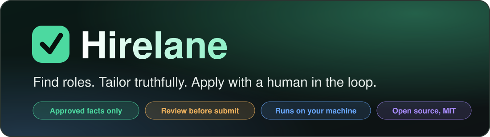
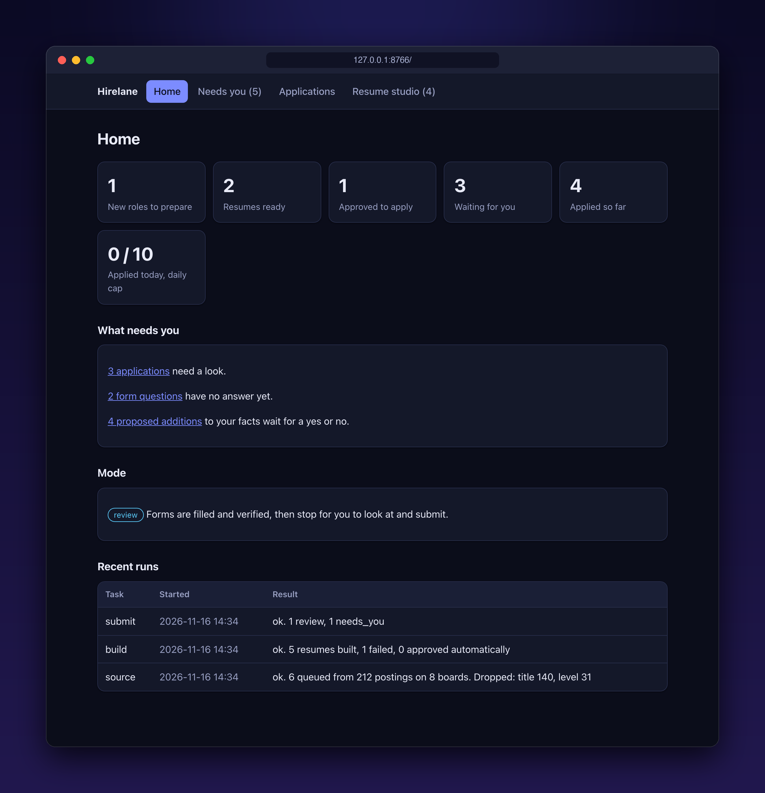
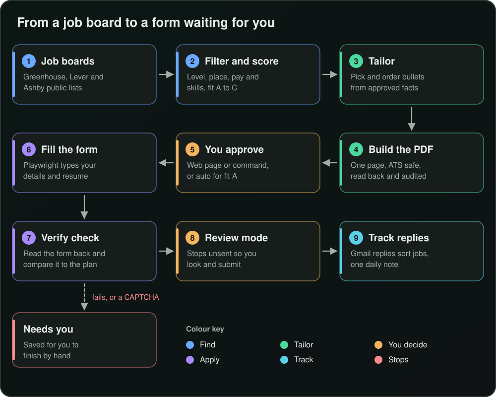
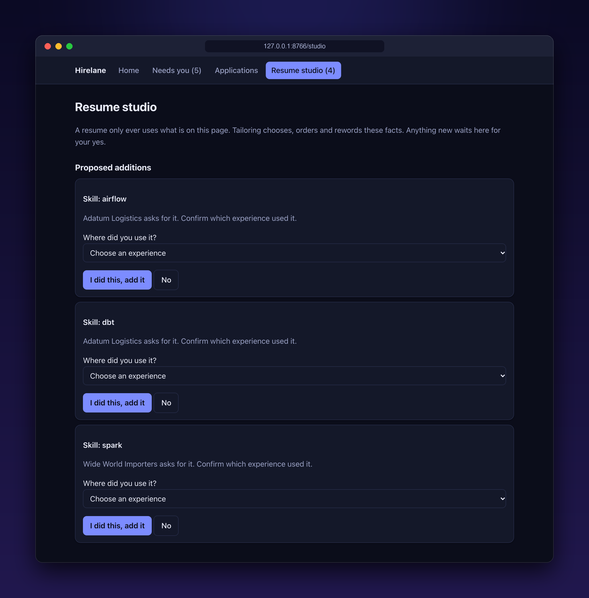
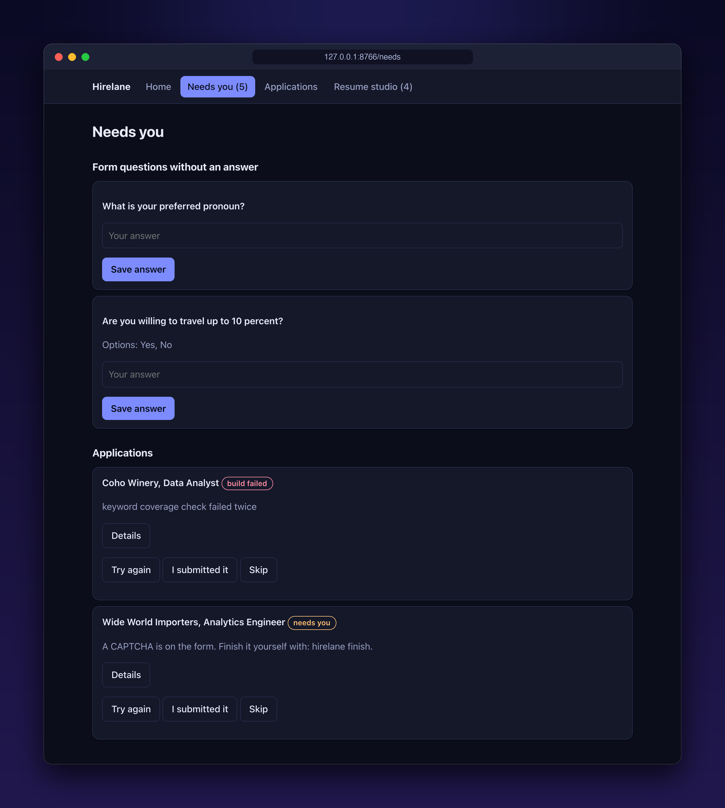
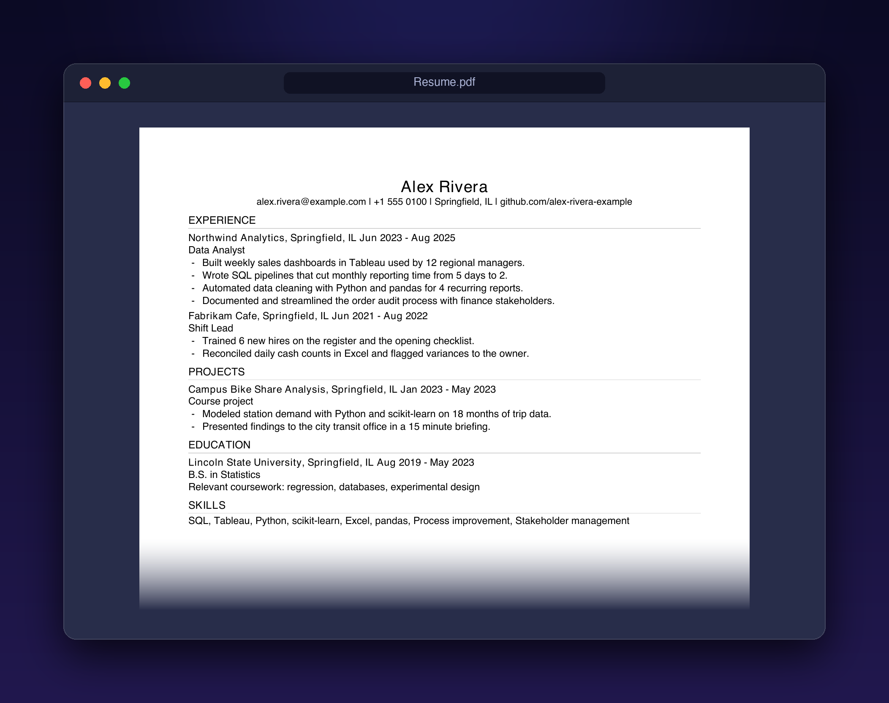

<div align="center">



[](../../actions/workflows/ci.yml)


[Install](#install)  ·  [First 10 minutes](#your-first-10-minutes)  ·  [How it works](#how-it-works)  ·  [Safety](#responsible-use-and-safety)  ·  [Troubleshooting](#troubleshooting)



</div>

## What is this?

Hirelane is a program that runs on your own computer and helps with a job search. It finds new job postings, decides
which ones fit you, and builds a resume for each one. It then fills in the application form and stops so you can look
at it before anything is sent. It only writes facts about you that you have approved, so a resume does not claim
experience you never listed.

> [!NOTE]
> The screenshots use an invented person, Alex Rivera. All data in this README is invented.

## Table of contents

1. [Why this exists](#why-this-exists)
2. [What it does](#what-it-does)
3. [How it works](#how-it-works)
4. [The truthfulness model](#the-truthfulness-model)
5. [Before you start](#before-you-start)
6. [Install](#install)
7. [Your first 10 minutes](#your-first-10-minutes)
8. [Daily use](#daily-use)
9. [Configuration reference](#configuration-reference)
10. [AI providers](#ai-providers)
11. [Optional integrations: Google](#optional-integrations-google)
12. [Running it automatically](#running-it-automatically)
13. [Responsible use and safety](#responsible-use-and-safety)
14. [Privacy](#privacy)
15. [Troubleshooting](#troubleshooting)
16. [FAQ](#faq)
17. [Uninstall](#uninstall)
18. [Roadmap, contributing, license](#roadmap)
19. [Acknowledgments](#acknowledgments)

## Why this exists

A serious job search means applying to dozens of roles. Each one deserves a resume that matches the posting. Doing that
by hand takes the better part of an hour per role, so most people stop tailoring and send one resume everywhere.

Many auto-apply tools go the other way. They send one generic resume to every posting, or they let a language model
write whatever scores well, including skills and numbers the candidate never had. A false line on a resume can end an
interview or a job.

Hirelane takes a middle path. Code does the repetitive work. You approve the facts once. Every resume is built only
from those facts, and every form stops for you before it goes out.

## What it does


- **Finds roles.** It reads the public job boards of the companies you list.
- **Filters by level and location.** It drops postings that are too senior, in the wrong place, or that need something you do not have, such as a security clearance.
- **Scores fit.** It rates each posting against your skills, with or without an AI model.
- **Tailors truthfully.** It picks, orders and rewords facts you approved, and nothing else.
- **Checks ATS formatting.** An ATS (applicant tracking system) is the software companies use to receive and sort applications. Hirelane builds one-page, single-column PDFs that these systems can read, then reads each PDF back to check it.
- **Fills forms and stops for review.** It types your details into the application form, checks the result, and waits for you.
- **Tracks replies.** If you connect Gmail, it sorts employer replies and updates each job.
- **Sends a daily summary.** A short list of what happened and what waits for you.
- **Has a phone-friendly dashboard.** You can review and approve from a browser on your phone.

## How it works

<p align="center">
  
</p>

1. **Public job boards.** Many companies post jobs through Greenhouse, Lever or Ashby. These services publish a list of
   open roles for each company. Hirelane reads that list for each company you add.
2. **Filter and score.** Plain code drops postings that do not match your level, location, pay floor or hard
   requirements. The rest get a fit score from A to C based on how many of your confirmed skills the posting wants.
3. **Tailor from approved facts.** For each posting, Hirelane chooses the best of your approved bullets and orders them.
   If you set up an AI provider, it may also reword a bullet, but only inside strict checks (see the next section).
4. **PDF and ATS check.** The resume is drawn as a one-page PDF with real text. A separate check reads the finished file
   and compares every line to your facts again. If anything fails, the job is marked "Build failed" and no form is
   touched.
5. **You approve.** Nothing is applied for until you approve that job, in the web page or with a command. An optional
   setting can approve strong matches for you.
6. **Fill the form.** A browser driven by a tool called Playwright opens the application page, fills the fields, and
   attaches the resume. Questions it cannot answer from your files are never guessed. They go to the "Needs you" page.
7. **Verify check.** A second pass reads the filled form back and compares it to the plan. Any mismatch stops the job.
8. **Review mode.** By default the form stays unsent. You look at it and submit it yourself.
9. **Reply tracking and summary.** If Gmail is connected, replies move jobs to Interview, Offer or Rejected. A short
   summary is written each day.

## The truthfulness model

Your approved facts live in files you can read. Tailoring may choose, reorder and reword them. It may never add to them.
A resume is built from these three rules:

1. A fact that is in your files can appear.
2. A reworded line is accepted only if code confirms it adds no new number, no new skill and no new name.
3. Anything else is a **proposal**. It waits for your yes. It never reaches a PDF until you approve it.

> [!IMPORTANT]
> Nothing you have not approved can appear on a resume or in a form answer. A bug in tailoring cannot add a skill
> on its own, because a second check reads the finished PDF back against your facts.

Here is an example with the invented candidate Alex Rivera.

| Step | Text |
| --- | --- |
| Original bullet, approved by Alex | Built weekly sales dashboards in Tableau used by 12 regional managers. |
| Wording in the job post | Build weekly dashboards that give business stakeholders a clear view of key metrics. Tableau or Looker. SQL required. dbt is a plus. |
| Tailored bullet on the resume | Created weekly Tableau sales dashboards for 12 regional managers. (an approved alternate wording that matches the post) |
| Proposed addition, waits for approval | Skill: dbt. The post asks for it and Alex has not confirmed it. It is shown in the Resume studio and stays off every PDF until Alex answers "I did this, add it". |
| Never written | Looker. Alex never confirmed it, so it is listed as a gap, not claimed. |



After the PDF is drawn, a second check reads it back and compares each bullet to the facts again. A bug in tailoring
is very unlikely to ship a line you did not approve. The full design is in [docs/ARCHITECTURE.md](docs/ARCHITECTURE.md).

## Before you start

You need three things.

1. **Python 3.11 or newer.** Python is the language Hirelane is written in. Python comes with a tool called pip that
   installs add-on packages.
2. **An AI provider key or a local model, if you want AI help.** An API key is a long secret string, like a password, that
   your AI provider gives you so a program can use their service. This is optional. Without it, everything works except
   AI rewording and AI scoring. See [AI providers](#ai-providers).
3. **About 15 minutes** for the first setup.

You also need a resume as a PDF or Word file, and a place to type commands. That place is called a terminal.

| System | How to open a terminal |
| --- | --- |
| macOS | Press Command and Space, type `Terminal`, press Return. |
| Windows | Press the Windows key, type `PowerShell`, press Return. |
| Linux | Press Ctrl, Alt and T. On most desktops this opens a terminal. |

### Check what you already have

Type each command and press Return. The output should look similar to the examples.

| Tool | Check command | Example output | Download |
| --- | --- | --- | --- |
| Python 3.11+ | macOS and Linux: `python3 --version`. Windows: `py --version` | `Python 3.12.4` | [python.org/downloads](https://www.python.org/downloads/) |
| Git (optional) | `git --version` | `git version 2.45.0` | [git-scm.com/downloads](https://git-scm.com/downloads) |

> [!TIP]
> If a command says "not found", install the tool from the download link and open a new terminal window. You can skip
> Git. The install steps below show a download option that does not need it.

## Install

Pick the section for your system. Every step is one action.

<details>
<summary><strong>macOS</strong></summary>

1. Get the code. With Git, copy the repository address from the green **Code** button on the project page, then run
   the line below with that address in place of `<repository-address>`:

   ```
   git clone <repository-address> hirelane
   ```

   Without Git, click **Code**, then **Download ZIP**, then double-click the file in your Downloads folder. Rename the
   new folder to `hirelane`.

2. Go into the folder. If you used the ZIP, adjust the path to where the folder is.

   ```
   cd hirelane
   ```

   You should see no output. Your prompt may now end with `hirelane`.

3. Create a private Python environment. This keeps Hirelane separate from other software.

   ```
   python3 -m venv .venv
   ```

   Nothing is printed. A new `.venv` folder appears.

4. Turn the environment on.

   ```
   source .venv/bin/activate
   ```

   Your prompt now starts with `(.venv)`. Repeat this step every time you open a new terminal.

5. Install Hirelane with the web interface, the browser tool and the Google tools. The words in square brackets are
   optional extras. Leave out `google` if you will never connect Google. This downloads a few packages and takes a
   minute or two. If pip says a newer version of pip is available, you can ignore that.

   ```
   pip install -e ".[web,browser,google]"
   ```

   The last line should say `Successfully installed` followed by a list that includes `hirelane-0.1.0`.

6. Install the browser that fills forms. Skip this step if you only want to try the demo.

   ```
   playwright install chromium
   ```

   You should see a download progress bar.

7. Check the install.

   ```
   hirelane --version
   ```

   You should see `hirelane 0.1.0`.

</details>

<details>
<summary><strong>Windows</strong></summary>

1. Get the code. With Git, copy the repository address from the green **Code** button, then run the line below with
   that address in place of `<repository-address>`:

   ```
   git clone <repository-address> hirelane
   ```

   Without Git, click **Code**, then **Download ZIP**. Right-click the file in Downloads, choose **Extract All**, and
   rename the new folder to `hirelane`.

2. Go into the folder. If you used the ZIP, adjust the path to where the folder is.

   ```
   cd hirelane
   ```

3. Create a private Python environment.

   ```
   py -m venv .venv
   ```

   Nothing is printed. A new `.venv` folder appears.

4. Turn the environment on.

   ```
   .venv\Scripts\Activate.ps1
   ```

   Your prompt now starts with `(.venv)`. If PowerShell says scripts are disabled, run
   `Set-ExecutionPolicy -Scope Process RemoteSigned` once and try again. That change lasts only for this window.

5. Install Hirelane with the web interface, the browser tool and the Google tools.

   ```
   pip install -e ".[web,browser,google]"
   ```

   The last line should say `Successfully installed` followed by a list that includes `hirelane-0.1.0`.

6. Install the browser that fills forms. Skip this step if you only want to try the demo.

   ```
   playwright install chromium
   ```

7. Check the install.

   ```
   hirelane --version
   ```

   You should see `hirelane 0.1.0`.

</details>

<details>
<summary><strong>Linux</strong></summary>

1. Install Python 3.11 or newer, the virtual environment package and Git from your package manager. On Debian or
   Ubuntu:

   ```
   sudo apt install python3 python3-venv git
   ```

   On Fedora, use `sudo dnf install python3 git`.

2. Get the code. Copy the repository address from the green **Code** button and run the line below with that address in
   place of `<repository-address>`:

   ```
   git clone <repository-address> hirelane
   ```

3. Go into the folder.

   ```
   cd hirelane
   ```

4. Create a private Python environment.

   ```
   python3 -m venv .venv
   ```

5. Turn the environment on.

   ```
   source .venv/bin/activate
   ```

   Your prompt now starts with `(.venv)`. Repeat this step every time you open a new terminal.

6. Install Hirelane with the web interface, the browser tool and the Google tools.

   ```
   pip install -e ".[web,browser,google]"
   ```

7. Install the browser that fills forms, together with the system libraries it needs. Skip this step if you only want
   to try the demo.

   ```
   playwright install --with-deps chromium
   ```

8. Check the install.

   ```
   hirelane --version
   ```

   You should see `hirelane 0.1.0`.

Hirelane stores secrets in your system keyring, the secure password store built into your operating system. On a
desktop Linux system this is usually GNOME Keyring or KWallet and works with no extra
steps. On a server with no keyring, see the troubleshooting table.

</details>

## Your first 10 minutes

### 1. Try the demo

The demo uses an invented person and invented jobs. It keeps its data in its own folder, `.hirelane-demo` in your
home folder, so it never touches your real data. It never opens a real job site.

1. Run the demo.

   ```
   hirelane demo
   ```

   You should see `Seeded demo data for Alex Rivera in` followed by a folder path, then
   `Open http://127.0.0.1:8766 (Ctrl+C to stop)`.

2. Open `http://127.0.0.1:8766` in your web browser. You will see four pages along the top.

   | Page | What it shows |
   | --- | --- |
   | Home | Counts of roles, resumes and applications, what needs you, and recent runs. |
   | Needs you | Form questions with no answer, and applications that need a look. |
   | Applications | Every role and its status. |
   | Resume studio | Your facts, and proposed additions waiting for a yes or no. |

3. Click **Applications**, then click any role in the list. You will see the tailored resume, the posting, and buttons to
   approve or skip.

   

   The page for a role shows each bullet and whether it is the original wording or a reworded one.

4. Click **Needs you**. This page lists the questions Hirelane refused to guess, and the applications that stopped
   for a person.

   

5. Open **Applications** to see every role and its status.

   

6. Press Ctrl and C in the terminal to stop the demo.

### 2. Set up with your own resume

1. Run the setup helper. Replace the path with your own file. A PDF or a Word file both work.

   ```
   hirelane init --resume ~/Documents/resume.pdf
   ```

   On Windows, use a path such as `C:\Users\you\Documents\resume.pdf`. A scanned resume that is only a picture will not
   work. The file needs text you can select.

   It reads your name, email and phone from the resume. It then asks a few short questions: the city where you live,
   whether you need visa sponsorship, whether you are allowed to work in your country, and (only if your resume does not
   show a job title) which job titles you want. Press Return to accept a suggested answer or to skip a question.

   When it finishes it prints how many experiences, bullets and skills it imported, and the folder where your files were
   written. The default is `.hirelane` in your home folder. To use another folder, set the `HIRELANE_HOME`
   environment variable (a named setting your terminal passes to programs) before you run any command. The demo ignores this variable and always uses `.hirelane-demo`.

   If `init` says a profile or facts already exist, you ran it before. Adding `--force` replaces those files, so only use
   it when you want to start over.

2. Check the setup.

   ```
   hirelane doctor
   ```

   It lists what works and what is missing. Missing AI or Google is fine at this point.

### 3. Review your fact bank

This is the most important step. Only what is in these files can ever appear on a resume.

1. Open the folder `.hirelane/config/experience` in your home folder. You will find one `.yaml` file per job, project
   or school, plus one for your skills. A YAML file is a plain text file that any text editor can open. The folder name
   starts with a dot, so Finder and File Explorer hide it. On macOS, run `open ~/.hirelane/config/experience` in the
   terminal, or press Command, Shift and Period in Finder to show hidden folders. On Windows, run
   `explorer %USERPROFILE%\.hirelane\config\experience`.

2. Open one file. It looks like this. The example is invented.

   ```yaml
   kind: work
   name: Northwind Analytics
   title: Data Analyst
   location: Springfield, IL
   dates:
     start: Jun 2023
     end: Aug 2025
   bullets:
     - id: dash
       text: Built weekly sales dashboards in Tableau used by 12 regional managers.
       skills: [tableau, sql]
       tracks: [data]
       variants:
         - Created weekly Tableau sales dashboards for 12 regional managers.
   skills:
     - name: Tableau
       status: confirmed
   ```

3. Fix anything the import got wrong. The import is a draft. It can mix up a job title and an employer, or put a
   graduation year in the wrong field, so read every file. Delete anything that is not true. Add a `variants` line for
   each way you are happy to word a bullet.

4. Open `.hirelane/config/profile.yaml`. Check your name, email and phone, which came from the resume. Then check the
   `tracks`. A track is one kind of role you want, with the job titles to look for. At least one track is needed,
   because a role only matches when its title contains one of a track's `titles`. If `tracks` is empty, copy the
   example from [Configuration reference](#profileyaml) and edit it. Run `hirelane doctor` again. It warns when no track
   exists.

### 4. Add companies and run once in review mode

1. Add a company. You need the company's board name. For Greenhouse, it is the last part of
   `boards.greenhouse.io/NAME`. For Lever, it is the last part of `jobs.lever.co/NAME`. For Ashby, it is the last part of
   `jobs.ashbyhq.com/NAME`.

   ```
   hirelane companies add greenhouse fabrikam "Fabrikam"
   ```

   Repeat for each company. Run `hirelane companies list` to see them all. With no companies it prints a hint instead.

2. Find roles and build resumes.

   ```
   hirelane run source build
   ```

   You will see a line for each step, such as how many roles were queued and how many resumes were built. Roles that
   fail a check are marked "Build failed" with a reason.

3. Start the web page.

   ```
   hirelane web
   ```

   Open `http://127.0.0.1:8766`. Your own roles are now listed. Press Ctrl and C to stop it later.

### 5. Approve your first application

1. In the web page, open **Applications** and click a role marked **Resume ready**.
2. Read the resume bullets and the posting. Click **Download resume** to see the PDF.

   

   The PDF is plain text in a single column, so an ATS can read it.

3. Click **Approve**. The command line version is `hirelane approve KEY`, where KEY is the role's identifier shown on
   the page, for example `greenhouse:fabrikam:1001`.
4. Fill the form.

   ```
   hirelane run submit
   ```

   Hirelane opens the application page in a hidden browser, fills it, checks it and stops. The role moves to
   **Ready for review**, or to **Needs you** if there was a CAPTCHA or an unanswered question.

5. Finish it yourself.

   ```
   hirelane finish greenhouse:fabrikam:1001
   ```

   This opens a visible window with the form already filled. Look at every field. Solve any CAPTCHA yourself. Click the
   site's Submit button when you are happy.

Nothing was sent until you pressed Submit in step 5.

## Daily use

After setup, a normal day looks like this.

| What | Who does it | Details |
| --- | --- | --- |
| Find new roles and build resumes | Hirelane, on a timer | Runs in the morning. |
| Fill approved forms | Hirelane, on a timer | Runs at midday and in the evening, up to the daily cap. |
| Read replies | Hirelane, on a timer | Only if Gmail is connected. |
| Write the daily summary | Hirelane, on a timer | Evening. |
| Approve roles | You | In the web page, or with `hirelane approve`. |
| Answer new form questions | You | On the Needs you page. Each answer is remembered. |
| Confirm proposed additions | You | In the Resume studio. |
| Solve CAPTCHAs (the "prove you are human" puzzles) and press Submit | You | With `hirelane finish`. |

To see where things stand at any time:

```
hirelane status
```

You will see the mode, the daily cap and how many applications went out so far. Once jobs exist, it also shows a count
of jobs in each status and how many items wait for you.

### Using it from your phone

By default the web page is only reachable from the same computer. To reach it from a phone, use a private network such
as Tailscale, so the page never faces the public internet.

1. Install Tailscale on the computer and the phone, and sign in to both.
2. Set a password-style token. The command asks you to type it, and it is stored in your keyring, the secure password
   store built into your operating system.

   ```
   hirelane set-key web-token
   ```

3. Start the page so it listens on the private network.

   ```
   hirelane web --host 0.0.0.0
   ```

4. On the phone, open `http://` followed by the computer's Tailscale name, then `:8766`. Sign in with the token.

> [!WARNING]
> Hirelane refuses to listen beyond the local machine without a token. Never expose the page to the public internet.

## Configuration reference

All files live in `.hirelane/config` in your home folder, unless you set `HIRELANE_HOME`. The files written by
`hirelane init` have comments next to every setting.

You can change a top-level setting without opening the file:

```
hirelane set daily_cap 5
```

### settings.yaml

| Setting | What it does | Default | Example |
| --- | --- | --- | --- |
| `submit_mode` | `review` fills and stops. `live` may submit, but only when `HIRELANE_ALLOW_LIVE=1` is also set. | `review` | `review` |
| `daily_cap` | The most forms filled or submitted in one day. | `10` | `5` |
| `delay_min_s` | Shortest random pause between forms, in seconds. | `20` | `30` |
| `delay_max_s` | Longest random pause between forms, in seconds. | `75` | `120` |
| `daily_target` | How many new roles to queue and prepare each day. | `10` | `8` |
| `posted_within_days` | Ignore postings older than this. | `7` | `14` |
| `auto_approve` | `none` means you approve each job. `fit_a` approves strong matches that need no unconfirmed skill. | `none` | `none` |
| `web_port` | The port for the web page. | `8766` | `8800` |
| `timezone` | A zone name such as `America/Chicago`. Empty uses your computer's zone. | empty | `America/Chicago` |
| `headless` | Run the form-filling browser with no window. `hirelane finish` always shows a window. | `true` | `true` |
| `google_enabled` | Turned on by `hirelane google connect`. | `false` | `false` |
| `ai` | The AI provider block. See [AI providers](#ai-providers). | provider `none` | see below |

### profile.yaml

Your contact details and the rules that decide which roles to look at.

| Setting | What it does | Default | Example |
| --- | --- | --- | --- |
| `name`, `email`, `phone` | Used on resumes and in forms. | from `init` | `Alex Rivera` |
| `location` | City, region, country and postal code. | from `init` | `city: Springfield` |
| `links` | Profile links to print on the resume. | from `init` | `github.com/alex-rivera-example` |
| `tracks` | The kinds of role you want. Each has `titles` to look for, `skills` that raise the score, and optional `exclude_titles`. | one track from `init` | see below |
| `level.max_years` | Drop postings that ask for more years than this. | `2` | `4` |
| `level.senior_words` | Title words that mean a senior role. | a standard list | `[senior, staff, lead]` |
| `level.allow_titles` | Titles to keep even when they contain a senior word. | empty | `[associate product manager]` |
| `search.scope` | `anywhere`, `country` or `regions`. | `country` | `regions` |
| `search.regions` | Text matched against the posting's location. | empty | `[illinois, chicago]` |
| `search.countries` | Country codes to search when the scope is `country`. | your country | `[US]` |
| `search.include_remote` | Keep remote roles. | `true` | `true` |
| `salary.floor` | Drop a posting whose posted maximum pay is below this. `0` turns it off. | `0` | `60000` |
| `salary.expectation` | What goes into salary fields. Empty means you are asked. | empty | `75000` |
| `knockouts.needs_sponsorship` | Drop roles that refuse visa sponsorship. | from `init` | `false` |
| `knockouts.has_clearance` | Whether you hold a security clearance. | `false` | `false` |
| `knockouts.degree` | `none`, `bachelors`, `masters` or `phd`. Roles that need more are dropped. | from `init` | `bachelors` |
| `knockouts.avoid_terms` | Words that rule a posting out. | empty | `[commission only]` |

A track looks like this:

```yaml
tracks:
  - name: data
    label: Data analytics
    titles: [data analyst, analytics engineer]
    skills: [sql, python, tableau]
  - name: ops
    label: Operations
    titles: [operations analyst, business analyst]
    skills: [sql, excel, process improvement]
    exclude_titles: [sales]
```

The filter rules (`level`, `search`, `salary`, `knockouts`) are the sections of this file that decide which postings
are dropped before scoring. The Home page shows a count of what was dropped and why.

### answers.yaml

Rules for form questions. A question is matched by a plain phrase, or by a pattern when the text starts with `re:`.
Your name, email, phone and links come from the profile. A required question with no rule is never guessed. It waits on
the Needs you page, and your answer is saved for next time.

| Setting | What it does | Default | Example |
| --- | --- | --- | --- |
| `answers[].match` | Phrases that identify the question. | none | `["authorized to work"]` |
| `answers[].answer` | The answer to type or choose. | none | `"Yes"` |

```yaml
answers:
  - match: ["authorized to work", "legally authorized"]
    answer: "Yes"
  - match: ["re:how did you (hear|find)"]
    answer: "Company website"
```

### companies.yaml

The boards to read. Add them with `hirelane companies add`, or edit the file.

| Setting | What it does | Default | Example |
| --- | --- | --- | --- |
| `ats` | The service: `greenhouse`, `lever` or `ashby`. | none | `greenhouse` |
| `slug` | The company's board name, the same name you used in `companies add`. | none | `fabrikam` |
| `name` | The name to show. | none | `Fabrikam` |

### experience/*.yaml

One file per job, project, school or skill list. This is your fact bank. The file name is the experience's key.

| Setting | What it does | Default | Example |
| --- | --- | --- | --- |
| `kind` | `work`, `project`, `education` or `skills`. | none | `work` |
| `name`, `title`, `location` | Shown on the resume. | none | `Data Analyst` |
| `dates.start`, `dates.end` | Dates, printed as written. | none | `Jun 2023` |
| `detail` | A degree line or a project link. | empty | `B.S. in Statistics` |
| `bullets[].text` | The approved wording of one achievement. | none | see above |
| `bullets[].variants` | Other approved wordings of the same fact. | empty | see above |
| `bullets[].skills` | Skills this bullet shows. | empty | `[tableau]` |
| `bullets[].tracks` | Tracks this bullet suits. Empty means all. | empty | `[data]` |
| `skills[].name` and `status` | A skill and whether it is `confirmed`, `denied` or `unsure`. Only confirmed skills reach a resume. | none | `Tableau`, `confirmed` |

## AI providers

AI is optional. It helps in two places: rewording a bullet to match a posting, and scoring fit. With no AI at all,
Hirelane still finds roles, scores them with a plain keyword matcher, picks and orders your approved bullets, builds
PDFs, fills forms, tracks replies and writes the summary.

Pick one provider. Open `.hirelane/config/settings.yaml` and edit the `ai` block, then store the key.

<details>
<summary><strong>Anthropic</strong></summary>

1. Create an account and an API key in the Anthropic console.
2. In `settings.yaml`, set:

   ```yaml
   ai:
     provider: anthropic
     model: <your-model-id>
     max_calls_per_run: 40
   ```

   Replace `<your-model-id>` with a model name from the provider's model list. A smaller, cheaper model is enough.

3. Store the key. The command asks you to paste it and does not show it.

   ```
   hirelane set-key ai-api-key
   ```

</details>

<details>
<summary><strong>OpenAI</strong></summary>

1. Create an account and an API key on the OpenAI platform.
2. In `settings.yaml`, set:

   ```yaml
   ai:
     provider: openai
     model: <your-model-id>
     max_calls_per_run: 40
   ```

3. Store the key.

   ```
   hirelane set-key ai-api-key
   ```

</details>

<details>
<summary><strong>A local model with Ollama</strong></summary>

Ollama runs models on your own computer, so nothing is sent anywhere and there is no bill.

1. Install Ollama from [ollama.com](https://ollama.com) and start it.
2. Download a model. Replace the name with one from the Ollama library.

   ```
   ollama pull <model-name>
   ```

3. In `settings.yaml`, set:

   ```yaml
   ai:
     provider: compatible
     model: <model-name>
     base_url: http://localhost:11434/v1
   ```

4. The `compatible` provider works with any server that speaks the OpenAI format. If your server needs a key, store it
   with `hirelane set-key ai-api-key`. Ollama does not.

Small local models reword less well. The checks still reject any bad reword, so the result is safe, but more bullets
fall back to your original wording.

</details>

### Rough cost

Hirelane makes at most `max_calls_per_run` calls per run, and each call is small. As a rough guide, a normal day with
a small hosted model usually costs little. A large model can cost several times more. Prices change, so check your provider's price page, and set `max_calls_per_run` lower to cap spending. A local
model costs nothing.

### What works with no AI

| Works | Does not work |
| --- | --- |
| Finding and filtering roles | Rewording bullets to match a posting |
| Keyword-based fit scoring | AI-assisted fit scoring |
| Choosing and ordering approved bullets | |
| PDF building and the ATS check | |
| Form filling, the verify check, reply tracking, the summary | |

## Optional integrations: Google

Google is optional. Connecting it adds a tracking spreadsheet, Gmail reply tracking, the daily summary by email, and
calendar slot suggestions. Hirelane carries no Google credentials. You create your own, once, and the steps take about
ten minutes. The same steps with more detail are in [docs/GOOGLE.md](docs/GOOGLE.md).

| Feature | What it does | Access it needs |
| --- | --- | --- |
| Google Sheets | Writes a tracking sheet. Decisions you type in the sheet are applied. | Sheets |
| Gmail | Reads recent mail to sort replies. Sends only the daily summary, only to your own address. | Gmail read and send |
| Calendar | Proposes free half-hour slots for a scheduling reply. | Calendar, read only |

<details>
<summary><strong>Full Google Cloud steps</strong></summary>

1. Open the Google Cloud console and create a project, for example `hirelane-personal`.
2. In **APIs and Services**, then **Library**, enable the Google Sheets API, the Gmail API and the Google Calendar API.
3. Open the **OAuth consent screen**. If the console shows the newer Google Auth Platform pages, the same settings are
   under **Branding**, **Audience** and **Data Access**.
4. Choose **External** and fill in the app name and your email.
5. Add these scopes:
   - `https://www.googleapis.com/auth/spreadsheets`
   - `https://www.googleapis.com/auth/gmail.readonly`
   - `https://www.googleapis.com/auth/gmail.send`
   - `https://www.googleapis.com/auth/calendar.readonly`
6. Add your own address as a test user.
7. **Publish the app.** While an app has the status Testing, Google expires its sign-in after 7 days, and Hirelane will
   start to say a token was refused. On the consent screen (or the Audience page) choose **Publish app** so the status
   becomes In production. The app stays unverified and only you use it. The first time you sign in, Google shows a
   warning. Choose **Advanced**, then continue to the app.
8. Under **Credentials**, choose **Create credentials**, then **OAuth client ID**, then **Desktop app**. Download the
   JSON file.
9. Connect. Replace the file name with the one you downloaded.

   ```
   hirelane google connect --client-file ~/Downloads/client_secret_example.json
   ```

   A browser window asks you to sign in and allow access. Afterwards, the client and token live in your system keyring.
   You can delete the downloaded file.

10. Check the connection.

    ```
    hirelane google status
    ```

If you ever see a refused-token message, run `hirelane google connect` again.

</details>

Once connected, these commands become useful:

| Command | What it does |
| --- | --- |
| `hirelane inbox` | Reads the last two days of mail, classifies replies and updates jobs. It never changes your mail. |
| `hirelane digest` | Writes the daily summary and emails it to you. Add `--no-email` to skip the email. |
| `hirelane sheet` | Writes the tracking sheet and applies approve or skip decisions you typed in it. |
| `hirelane slots` | Prints free calendar slots for a scheduling reply. |
| `hirelane google disconnect` | Removes the token and turns the feature off. |

## Running it automatically

`hirelane schedule install` sets up four timed jobs: find roles and build resumes in the morning, fill approved forms
at midday and in the evening, read replies four times a day, and write the summary in the evening.

```
hirelane schedule install
```

It uses the right tool for your system.

| System | What gets created |
| --- | --- |
| macOS | launchd jobs (macOS's built-in scheduler) in `~/Library/LaunchAgents`. |
| Linux | systemd user timers (Linux's built-in scheduler) in `~/.config/systemd/user`. |
| Windows | It prints Task Scheduler commands for you to run. |
| Anything else | Use `hirelane schedule show` to print the jobs, then copy them into cron, the classic Unix scheduler. |

For cron, a line looks like this. Replace the path with the full path to your `hirelane` command, which you can find
by running `which hirelane` on macOS and Linux.

```
30 7 * * * /full/path/to/hirelane run source build
```

| Task | Command |
| --- | --- |
| See what would be installed | `hirelane schedule show` |
| Status | `hirelane status` |
| Pause | `hirelane schedule uninstall` |
| Resume | `hirelane schedule install` |

Scheduled runs never open a window. Only `hirelane finish` does.

## Responsible use and safety

Hirelane is a tool for people who still read each posting. It is built so the safe choice is the default.

> [!WARNING]
> Some job boards and companies forbid automated applications. Read the terms of each site you point Hirelane at, and
> the hiring company's policy. You are responsible for how you use this tool.

- **Review mode is the default.** Forms are filled and checked, then stop for you. Live submission is opt-in and needs
  two switches: `submit_mode: live` in the settings and the environment variable `HIRELANE_ALLOW_LIVE=1`.
- **It never solves CAPTCHAs.** A CAPTCHA is the "prove you are human" puzzle. If a form shows one, the job is handed
  to you.
- **It never creates accounts.** Sites that need a login are not supported.
- **It never invents experience.** Not on a resume and not in a form answer. A required question with no answer
  waits for you.
- **It limits itself.** The daily cap defaults to 10. Random pauses sit between forms. Two failed checks on a form stop
  that form.
- **Two checks before any live click.** A form must pass the zero-error check and a re-read of what was filled.

## Privacy

- Your data stays on your computer. The database, resumes, facts and answers are plain files in `.hirelane`.
- Secrets live in your operating system's keyring, never in config files or logs.
- Data leaves your computer in only two ways. Posting and resume text goes to the AI provider you chose, if you chose
  one. And the browser talks to the job sites you apply to.
- There is no telemetry and no account with this project.

See [SECURITY.md](SECURITY.md) for how to report a problem.

## Troubleshooting

| Symptom | Likely cause | Fix |
| --- | --- | --- |
| `hirelane: command not found` | The Python environment is not turned on. | Run the activate step from the install section again, then retry. |
| `No module named 'fastapi'` | The web extra was not installed. | Run `pip install -e ".[web,browser,google]"` again from the project folder. |
| `Executable doesn't exist` when filling a form | The browser was not downloaded. | Run `playwright install chromium`. |
| `Address already in use` | Another program uses port 8766. | Run `hirelane web --port 8800`, or change `web_port`. |
| The web page will not start with `--host 0.0.0.0` | No token is set. | Run `hirelane set-key web-token`, then try again. |
| `init` says a profile or facts already exist | You ran `init` before in this folder. | Keep your files, or run `hirelane init --resume FILE --force` to start over. This replaces them. |
| `init` says the file has no readable text | The resume is a scan or an image. | Export a PDF with selectable text, or use a Word file. |
| No roles appear after a run | No companies were added, or all were filtered out. | Run `hirelane companies list`. Add companies. Check the Home page for what was dropped. |
| A role says Build failed | The resume could not meet the keyword or fact checks with your approved facts. | Open the role to see the reason. Add a true fact in the Resume studio, or skip the role. |
| A role says Needs you | A CAPTCHA, an unanswered question, or a failed check. | Answer on the Needs you page, or run `hirelane finish KEY` and finish it yourself. |
| Nothing was filled today | The daily cap was reached, or no job is approved. | Run `hirelane status`. Raise `daily_cap` or approve more roles. |
| Live mode does nothing | Live needs both switches. | Set `submit_mode: live` and `HIRELANE_ALLOW_LIVE=1`. Read the safety section first. |
| `keyring` errors on Linux | There is no system keyring. | Install GNOME Keyring, or set the secret as an environment variable named like `HIRELANE_SECRET_AI_API_KEY`. |
| Gmail or Sheets say a token was refused | The Google app is still in Testing and the token expired. | Publish the app as described above, then run `hirelane google connect` again. |
| PowerShell says scripts are disabled | The default execution policy blocks the activate script. | Run `Set-ExecutionPolicy -Scope Process RemoteSigned`, then activate again. |

Run `hirelane doctor` first. It checks the setup and says what is missing.

## FAQ

**Do I need an AI provider?**
No. Everything except AI rewording and AI scoring works without one.

**Will it apply to jobs without asking me?**
No, not by default. In review mode every form stops for you, and every job needs your approval first.

**Can it make up a skill to match a posting?**
No. A skill a posting wants that you have not confirmed is listed as a gap. It becomes a proposal that waits for your
answer, and it stays off every PDF until you approve it.

**Which job sites does it support?**
Greenhouse, Lever and Ashby boards. Sites that need an account, such as Workday, are not supported yet.

**Is it free?**
The software is free under the MIT license. An AI provider may charge you. A local model does not.

**Does it work on Windows?**
It is expected to. The install steps above are written for Windows, but the automated tests run only on Linux and macOS.
The scheduler step prints commands for you to run.

**Where is my data?**
In the `.hirelane` folder in your home folder. Set `HIRELANE_HOME` to move it.

**What happens when a form has a CAPTCHA?**
Hirelane stops and marks the role as Needs you. You run `hirelane finish KEY`, solve it yourself and submit.

**How do I stop it?**
Press Ctrl and C to stop the web page. Run `hirelane schedule uninstall` to stop the timed jobs.

**Can I use it for several kinds of role?**
Yes. Add one track per kind of role in `profile.yaml`. Bullets can be tagged with the tracks they suit.

## Uninstall

1. Stop the timed jobs.

   ```
   hirelane schedule uninstall
   ```

2. Remove the secrets from your keyring. Open your system's keyring app (Keychain Access on macOS, Credential Manager
   on Windows, Passwords and Keys on GNOME) and delete the entries named `hirelane`.
3. Remove the Python environment and the code by deleting the `hirelane` folder you cloned or unzipped.
4. Remove your data by deleting the `.hirelane` folder in your home folder. If you ran the demo, also delete the
   `.hirelane-demo` folder. This deletes your fact bank and your
   database. Keep a copy of `.hirelane/config/experience` first if you want to keep your facts.
5. If you connected Google, also remove access from your Google account's security page.

## Roadmap

- More boards (SmartRecruiters, Workable) as adapters
- A cover letter step that follows the same fact rules
- A Windows scheduler install that does not need copy and paste
- Import from LinkedIn data exports
- An editor for the fact bank in the web interface

## Contributing

Bug reports, fixtures and adapters are welcome. [CONTRIBUTING.md](CONTRIBUTING.md) explains setup and the rules that
protect users. The design is in [docs/ARCHITECTURE.md](docs/ARCHITECTURE.md).

## License

MIT. See [LICENSE](LICENSE).

## Acknowledgments

Hirelane stands on open source work, including [Playwright](https://playwright.dev), [FastAPI](https://fastapi.tiangolo.com),
[Uvicorn](https://www.uvicorn.org), [Jinja](https://jinja.palletsprojects.com), [httpx](https://www.python-httpx.org),
[ReportLab](https://www.reportlab.com/opensource/), [pypdf](https://pypdf.readthedocs.io), [PyYAML](https://pyyaml.org),
[keyring](https://github.com/jaraco/keyring) and the Google API client libraries.
