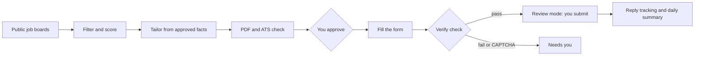
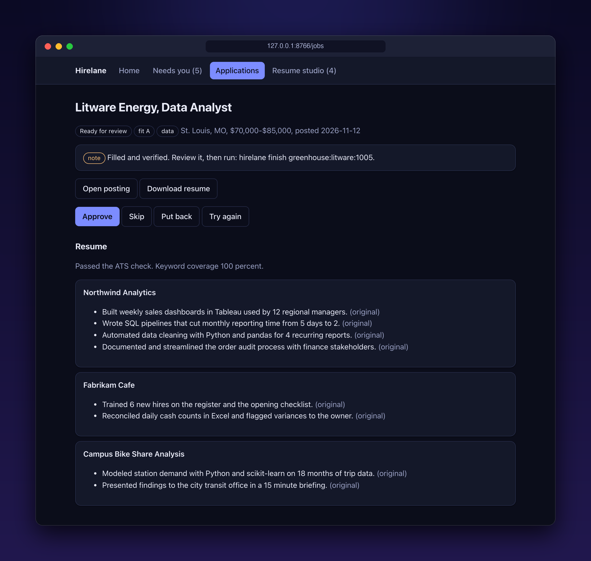
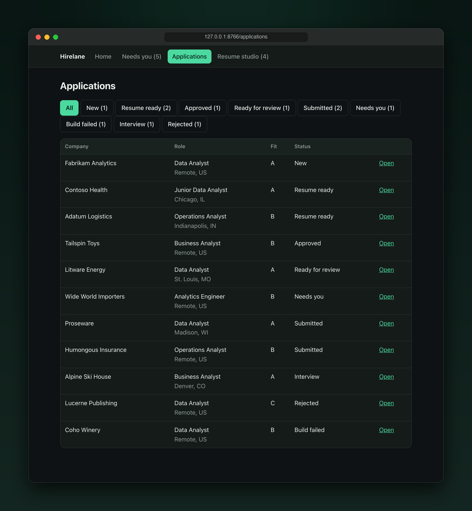

# Hirelane

Find roles, tailor your resume truthfully, and apply with a human in the loop.

[](../../actions/workflows/ci.yml)
[](LICENSE)
[](https://www.python.org/downloads/)

## What is this?

Hirelane is a program that runs on your own computer and helps with a job search. It finds new job postings, decides
which ones fit you, and builds a resume for each one. It then fills in the application form and stops so you can look
at it before anything is sent. It only writes facts about you that you have approved, so a resume does not claim
experience you never listed.


The screenshot uses an invented person, Alex Rivera. All data in this README is invented.

## Table of contents

1. [Why this exists](#why-this-exists)
2. [What it does](#what-it-does)
3. [How it works](#how-it-works)
4. [The truthfulness model](#the-truthfulness-model)
5. [Before you start](#before-you-start)
6. [Install](#install)
7. [Your first 10 minutes](#your-first-10-minutes)
8. [Daily use](#daily-use)
9. [Configuration reference](#configuration-reference)
10. [AI providers](#ai-providers)
11. [Optional integrations: Google](#optional-integrations-google)
12. [Running it automatically](#running-it-automatically)
13. [Responsible use and safety](#responsible-use-and-safety)
14. [Privacy](#privacy)
15. [Troubleshooting](#troubleshooting)
16. [FAQ](#faq)
17. [Uninstall](#uninstall)
18. [Roadmap, contributing, license](#roadmap)
19. [Acknowledgments](#acknowledgments)

## Why this exists

A serious job search means applying to dozens of roles. Each one deserves a resume that matches the posting. Doing that
by hand takes the better part of an hour per role, so most people stop tailoring and send one resume everywhere.

Many auto-apply tools go the other way. They send one generic resume to every posting, or they let a language model
write whatever scores well, including skills and numbers the candidate never had. A false line on a resume can end an
interview or a job.

Hirelane takes a middle path. Code does the repetitive work. You approve the facts once. Every resume is built only
from those facts, and every form stops for you before it goes out.

## What it does

- **Finds roles.** It reads the public job boards of the companies you list.
- **Filters by level and location.** It drops postings that are too senior, in the wrong place, or that need something you do not have, such as a security clearance.
- **Scores fit.** It rates each posting against your skills, with or without an AI model.
- **Tailors truthfully.** It picks, orders and rewords facts you approved, and nothing else.
- **Checks ATS formatting.** An ATS (applicant tracking system) is the software companies use to receive and sort applications. Hirelane builds one-page, single-column PDFs that these systems can read, then reads each PDF back to check it.
- **Fills forms and stops for review.** It types your details into the application form, checks the result, and waits for you.
- **Tracks replies.** If you connect Gmail, it sorts employer replies and updates each job.
- **Sends a daily summary.** A short list of what happened and what waits for you.
- **Has a phone-friendly dashboard.** You can review and approve from a browser on your phone.

## How it works



1. **Public job boards.** Many companies post jobs through Greenhouse, Lever or Ashby. These services publish a list of
   open roles for each company. Hirelane reads that list for each company you add.
2. **Filter and score.** Plain code drops postings that do not match your level, location, pay floor or hard
   requirements. The rest get a fit score from A to C based on how many of your confirmed skills the posting wants.
3. **Tailor from approved facts.** For each posting, Hirelane chooses the best of your approved bullets and orders them.
   If you set up an AI provider, it may also reword a bullet, but only inside strict checks (see the next section).
4. **PDF and ATS check.** The resume is drawn as a one-page PDF with real text. A separate check reads the finished file
   and compares every line to your facts again. If anything fails, the job is marked "Build failed" and no form is
   touched.
5. **You approve.** Nothing is applied for until you approve that job, in the web page or with a command. An optional
   setting can approve strong matches for you.
6. **Fill the form.** A browser driven by a tool called Playwright opens the application page, fills the fields, and
   attaches the resume. Questions it cannot answer from your files are never guessed. They go to the "Needs you" page.
7. **Verify check.** A second pass reads the filled form back and compares it to the plan. Any mismatch stops the job.
8. **Review mode.** By default the form stays unsent. You look at it and submit it yourself.
9. **Reply tracking and summary.** If Gmail is connected, replies move jobs to Interview, Offer or Rejected. A short
   summary is written each day.

## The truthfulness model

Your approved facts live in files you can read. Tailoring may choose, reorder and reword them. It may never add to them.
A resume is built from these three rules:

1. A fact that is in your files can appear.
2. A reworded line is accepted only if code confirms it adds no new number, no new skill and no new name.
3. Anything else is a **proposal**. It waits for your yes. It never reaches a PDF until you approve it.

Here is an example with the invented candidate Alex Rivera.

| Step | Text |
| --- | --- |
| Original bullet, approved by Alex | Built weekly sales dashboards in Tableau used by 12 regional managers. |
| Wording in the job post | Build weekly dashboards that give business stakeholders a clear view of key metrics. Tableau or Looker. SQL required. dbt is a plus. |
| Tailored bullet on the resume | Created weekly Tableau sales dashboards for 12 regional managers. (an approved alternate wording that matches the post) |
| Proposed addition, waits for approval | Skill: dbt. The post asks for it and Alex has not confirmed it. It is shown in the Resume studio and stays off every PDF until Alex answers "I did this, add it". |
| Never written | Looker. Alex never confirmed it, so it is listed as a gap, not claimed. |


After the PDF is drawn, a second check reads it back and compares each bullet to the facts again. A bug in tailoring
is very unlikely to ship a line you did not approve. The full design is in [docs/ARCHITECTURE.md](docs/ARCHITECTURE.md).

## Before you start

You need three things.

1. **Python 3.11 or newer.** Python is the language Hirelane is written in. Python comes with a tool called pip that
   installs add-on packages.
2. **An AI provider key or a local model, if you want AI help.** An API key is a long secret string, like a password, that
   your AI provider gives you so a program can use their service. This is optional. Without it, everything works except
   AI rewording and AI scoring. See [AI providers](#ai-providers).
3. **About 15 minutes** for the first setup.

You also need a resume as a PDF or Word file, and a place to type commands. That place is called a terminal.

| System | How to open a terminal |
| --- | --- |
| macOS | Press Command and Space, type `Terminal`, press Return. |
| Windows | Press the Windows key, type `PowerShell`, press Return. |
| Linux | Press Ctrl, Alt and T. On most desktops this opens a terminal. |

### Check what you already have

Type each command and press Return. The output should look similar to the examples.

| Tool | Check command | Example output | Download |
| --- | --- | --- | --- |
| Python 3.11+ | macOS and Linux: `python3 --version`. Windows: `py --version` | `Python 3.12.4` | [python.org/downloads](https://www.python.org/downloads/) |
| Git (optional) | `git --version` | `git version 2.45.0` | [git-scm.com/downloads](https://git-scm.com/downloads) |

If the command says "not found", install the tool from the download link and open a new terminal window. You can skip
Git. The install steps below show a download option that does not need it.

## Install

Pick the section for your system. Every step is one action.

<details>
<summary><strong>macOS</strong></summary>

1. Get the code. With Git, copy the repository address from the green **Code** button on the project page, then run
   the line below with that address in place of `<repository-address>`:

   ```
   git clone <repository-address> hirelane
   ```

   Without Git, click **Code**, then **Download ZIP**, then double-click the file in your Downloads folder. Rename the
   new folder to `hirelane`.

2. Go into the folder. If you used the ZIP, adjust the path to where the folder is.

   ```
   cd hirelane
   ```

   You should see no output. Your prompt may now end with `hirelane`.

3. Create a private Python environment. This keeps Hirelane separate from other software.

   ```
   python3 -m venv .venv
   ```

   Nothing is printed. A new `.venv` folder appears.

4. Turn the environment on.

   ```
   source .venv/bin/activate
   ```

   Your prompt now starts with `(.venv)`. Repeat this step every time you open a new terminal.

5. Install Hirelane with the web interface, the browser tool and the Google tools. The words in square brackets are
   optional extras. Leave out `google` if you will never connect Google. This downloads a few packages and takes a
   minute or two. If pip says a newer version of pip is available, you can ignore that.

   ```
   pip install -e ".[web,browser,google]"
   ```

   The last line should say `Successfully installed` followed by a list that includes `hirelane-0.1.0`.

6. Install the browser that fills forms. Skip this step if you only want to try the demo.

   ```
   playwright install chromium
   ```

   You should see a download progress bar.

7. Check the install.

   ```
   hirelane --version
   ```

   You should see `hirelane 0.1.0`.

</details>

<details>
<summary><strong>Windows</strong></summary>

1. Get the code. With Git, copy the repository address from the green **Code** button, then run the line below with
   that address in place of `<repository-address>`:

   ```
   git clone <repository-address> hirelane
   ```

   Without Git, click **Code**, then **Download ZIP**. Right-click the file in Downloads, choose **Extract All**, and
   rename the new folder to `hirelane`.

2. Go into the folder. If you used the ZIP, adjust the path to where the folder is.

   ```
   cd hirelane
   ```

3. Create a private Python environment.

   ```
   py -m venv .venv
   ```

   Nothing is printed. A new `.venv` folder appears.

4. Turn the environment on.

   ```
   .venv\Scripts\Activate.ps1
   ```

   Your prompt now starts with `(.venv)`. If PowerShell says scripts are disabled, run
   `Set-ExecutionPolicy -Scope Process RemoteSigned` once and try again. That change lasts only for this window.

5. Install Hirelane with the web interface, the browser tool and the Google tools.

   ```
   pip install -e ".[web,browser,google]"
   ```

   The last line should say `Successfully installed` followed by a list that includes `hirelane-0.1.0`.

6. Install the browser that fills forms. Skip this step if you only want to try the demo.

   ```
   playwright install chromium
   ```

7. Check the install.

   ```
   hirelane --version
   ```

   You should see `hirelane 0.1.0`.

</details>

<details>
<summary><strong>Linux</strong></summary>

1. Install Python 3.11 or newer, the virtual environment package and Git from your package manager. On Debian or
   Ubuntu:

   ```
   sudo apt install python3 python3-venv git
   ```

   On Fedora, use `sudo dnf install python3 git`.

2. Get the code. Copy the repository address from the green **Code** button and run the line below with that address in
   place of `<repository-address>`:

   ```
   git clone <repository-address> hirelane
   ```

3. Go into the folder.

   ```
   cd hirelane
   ```

4. Create a private Python environment.

   ```
   python3 -m venv .venv
   ```

5. Turn the environment on.

   ```
   source .venv/bin/activate
   ```

   Your prompt now starts with `(.venv)`. Repeat this step every time you open a new terminal.

6. Install Hirelane with the web interface, the browser tool and the Google tools.

   ```
   pip install -e ".[web,browser,google]"
   ```

7. Install the browser that fills forms, together with the system libraries it needs. Skip this step if you only want
   to try the demo.

   ```
   playwright install --with-deps chromium
   ```

8. Check the install.

   ```
   hirelane --version
   ```

   You should see `hirelane 0.1.0`.

Hirelane stores secrets in your system keyring, the secure password store built into your operating system. On a
desktop Linux system this is usually GNOME Keyring or KWallet and works with no extra
steps. On a server with no keyring, see the troubleshooting table.

</details>

## Your first 10 minutes

### 1. Try the demo

The demo uses an invented person and invented jobs. It keeps its data in its own folder, `.hirelane-demo` in your
home folder, so it never touches your real data. It never opens a real job site.

1. Run the demo.

   ```
   hirelane demo
   ```

   You should see `Seeded demo data for Alex Rivera in` followed by a folder path, then
   `Open http://127.0.0.1:8766 (Ctrl+C to stop)`.

2. Open `http://127.0.0.1:8766` in your web browser. You will see four pages along the top.

   | Page | What it shows |
   | --- | --- |
   | Home | Counts of roles, resumes and applications, what needs you, and recent runs. |
   | Needs you | Form questions with no answer, and applications that need a look. |
   | Applications | Every role and its status. |
   | Resume studio | Your facts, and proposed additions waiting for a yes or no. |

3. Click **Applications**, then click any role in the list. You will see the tailored resume, the posting, and buttons to
   approve or skip.

   

   The page for a role shows each bullet and whether it is the original wording or a reworded one.

4. Click **Needs you**. This page lists the questions Hirelane refused to guess, and the applications that stopped
   for a person.

   

5. Open **Applications** to see every role and its status.

   

6. Press Ctrl and C in the terminal to stop the demo.
