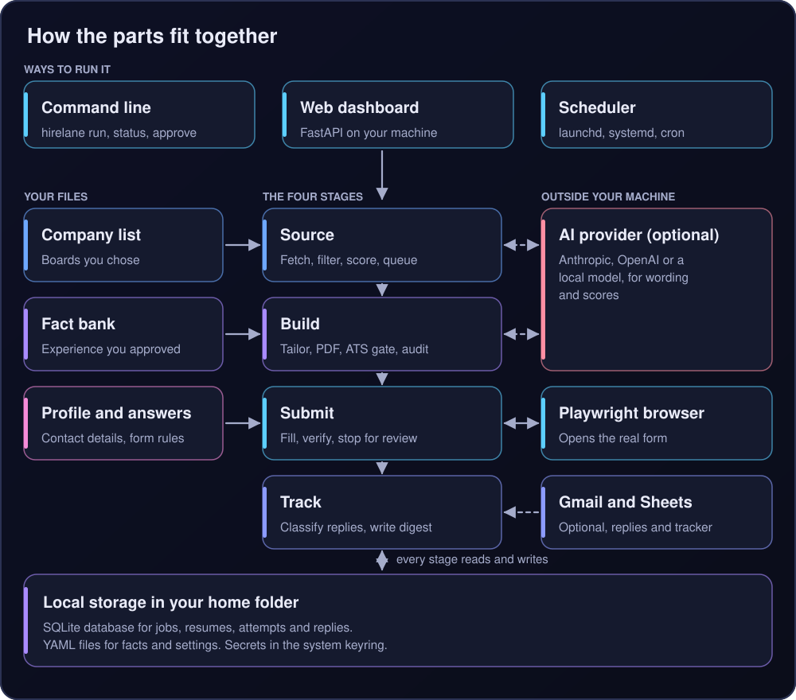

# Architecture

Hirelane is a local Python application. A command line, a scheduler and a web interface all drive the same pipeline
and read the same SQLite database and fact bank. This page explains how each part works and why it is built that way.

  

## The pipeline stages

Each stage is a function in `hirelane/pipeline.py` that records itself in the `runs` table. A failure is recorded and
the next stage still runs.

1. **Source** (`sourcing.py`). Boards listed in `config/companies.yaml` are fetched concurrently from their public JSON
   APIs (`sources/`). Each posting is checked cheaply first on its title and location (`filters.check_title`), and only
   survivors have their HTML description converted to text. That ordering matters because HTML conversion dominates the
   cost and most postings fail on the title. Survivors pass the description checks: freshness, seniority
   (`level.py`), the user's pay floor (`salary.py`) and knockouts such as sponsorship or clearance
   (`knockout.py`). They are scored by `scoring.py`, and the best one per company, up to `daily_target`, are queued.
2. **Build** (`build.py`). For each queued job, `tailor.py` produces resume content, `pdf.py` renders it,
   `ats_gate.py` checks it, and `readthrough.py` adds notes. A gate failure triggers one rebuild using approved wording
   only. A second failure marks the job `Build failed` with the reason.
3. **Approve.** By default the user approves in the web interface or with `hirelane approve`. With
   `auto_approve: fit_a`, strong matches with a clean resume and no unconfirmed skills are approved for them.
4. **Submit** (`submit/runner.py`). Approved jobs are processed one at a time, with a random pause between them and a
   daily cap that counts fills as well as submits.
5. **Track** (`inbox.py`, `digest.py`). Replies move jobs forward. The digest summarizes the day.

## Data model

`db.py` owns one SQLite file. The tables that matter:

| Table | Holds |
| --- | --- |
| `jobs` | One row per posting that was queued. The key is `ats:slug:id`. Status moves through `New`, `Resume ready`, `Approved`, `Submitting`, `Ready for review`, `Submitted`, `Interview`, `Offer`, `Rejected` with side states `Needs you`, `Build failed`, `Skip` and `Closed`. |
| `resumes` | The stored resume record for a job, its file hash, and the ATS gate result. |
| `attempts` | A log of phases per job, such as `filled`, `submit_clicked`, `captcha_blocked`. |
| `questions` | Required form questions with no answer rule, shared by every job that asked. |
| `proposals` | Additions to the fact bank that wait for the user. |
| `emails` | Classified replies. |
| `runs` | One row per pipeline step. |

Two design choices follow from this. SQLite is the source of truth, so a sheet or a web page can be wrong and nothing is
lost. And a job is claimed with a time-limited lock (`DB.claim`) before a form is touched, so two runs cannot fill the
same form.

## The truthfulness model

This is the core of the project. The user's approved facts live in `config/experience/*.yaml`, one file per job,
project or school. Each fact is explicit:

- bullets with an id, the approved text, optional approved variants, the skills they involve and the tracks they suit
- skills with a status of `confirmed`, `denied` or `unsure`
- metrics, in the exact wording the user approved

Tailoring (`tailor.py`) may do three things with these facts: **choose** which bullets to include, **order** them by
relevance to the posting, and **reword** a few under validation. It may not add anything.

Rewording is where a model could invent, so it is checked by plain code (`truth.check_rewrite`), not by trust. A reword
is accepted only if all of this holds:

- it adds no number that is not in the approved bullet or the experience's metrics
- it adds no skill from the shared vocabulary that the approved bullet does not already contain, which also covers
  skills the user has denied
- it adds no proper name, such as a product or a company
- it keeps at least half of the original's content words, so it is a reword and not a new claim
- it passes the house style checks in `voice.py`

A reword that fails only because it names a skill becomes a **proposal**. The user sees it in the Resume studio and can
approve it, which writes it into the fact bank as an extra approved wording. Skills a posting asks for that the user has
not confirmed are proposals too. They never reach a resume until confirmed.

The check does not stop at tailoring. `ats_gate.check_pdf` re-reads the finished PDF and runs `truth.audit_content` on
the stored resume record. Every bullet must trace to an approved bullet or a validated rewrite, and every skill must be
confirmed. A bug in tailoring cannot ship a false line, because the gate does not know or care how the line was made.

Without an AI provider the same pipeline runs. Matching uses the deterministic scorer and tailoring chooses and orders
approved wording only.

## Submission safety gates

A form passes through these in order, and each can stop it.

1. **Pre-flight** (`submit/gate.py`). The ATS is supported, the apply URL is on that ATS's domain, the daily cap is not
   reached, and the resume file exists, is unchanged since it passed the ATS gate (SHA-256), and carries the right
   company key in its name.
2. **Unresolved click check** (`runner.click_is_unresolved`). If an earlier run clicked submit and never saw a
   confirmation, the form may have been sent. It is never repeated automatically. The user checks their inbox and runs
   `hirelane clear-click`.
3. **Fill and read back** (`submit/base.py`). The scanner tags every field and never sets a value. Playwright then fills
   with real input events. The form is scanned again afterwards.
4. **CAPTCHA.** If one is on the page the job goes to the user. There is no solver and no attempt to get around one.
5. **Verification gate** (`submit/verify.py`). Every required field is filled, the resume upload shows the expected file
   name, each planned value reads back as planned, no placeholder text is present, no other tracked company's name
   appears in a field, and the page shows no validation error. A required question with no answer rule is reported
   rather than guessed.
6. **Mode.** In review mode, the default, the job becomes `Ready for review` with a screenshot and the user submits with
   `hirelane finish`. Live mode needs `submit_mode: live` in the settings and `HIRELANE_ALLOW_LIVE=1` in the
   environment. Even then the submit click is written to `attempts` before it happens.

## How adapters work

An adapter (`submit/greenhouse.py`, `lever.py`, `ashby.py`) is about twenty lines. It supplies:

- `form_url(job)`, the page that holds the form
- `ready_selector` and `submit_selector`
- `confirm_patterns` and, where the URL tells, an override of `confirmed_now`

The shared `Adapter` base in `submit/base.py` does the rest. `open` refuses any URL outside the ATS's domains and
checks again after redirects. `fill` runs up to three passes of scan, plan and fill, because answering one question can
reveal another. The answer plan (`submit/plan.py`) maps each field label to a rule from `answers.yaml`, falling back to
the profile for identity fields. Option matching for dropdowns and radios lives in `submit/optmatch.py`, which handles
yes and no synonyms and prefixes.

To add a board, subclass `Adapter`, add it to `ADAPTERS` in `submit/__init__.py`, add a source module with a `parse`
function, and save a fixture form under `tests/fixtures/forms`.

## Other parts worth knowing

- **Providers** (`providers/`). One `Provider` protocol with `complete(system, user)`. Backends are plain `httpx` calls
  for Anthropic, OpenAI and any OpenAI-compatible server. `LimitedProvider` caps calls per run. Text from postings and
  emails is wrapped with `untrusted()` so a model treats it as data, and every reply is parsed and validated before use.
- **Secrets** (`secrets.py`). A thin wrapper over the OS keyring with a fixed service name.
- **Web interface** (`web/`). FastAPI and Jinja. It binds to loopback unless a token is set, uses a signed same-site
  cookie, and checks the Origin header on posts.
- **Scheduling** (`schedule.py`). Pure render functions for launchd plists, systemd units and `schtasks` commands, so
  they are tested without installing anything.
- **Google** (`google/`). Optional and lazy. Nothing imports it until the user connects an account.
